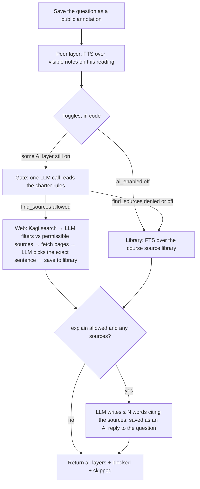

# How the backend works

A high-level tour of `app/backend/`, written Saturday 01:35. `SPEC.md` says *what* we're building; this explains *how the code is arranged* so you can find your way around and change it. If the code and this file disagree, the code wins: fix this file.

## The shape of it

The whole backend is **one Python process** (FastAPI, served by uvicorn) talking to **one SQLite file** (`app/backend/dialectic.db`). There's no ORM, no background workers and no cache server. Every request reads and writes the database directly with SQL, and the two outside services (the LLM and Kagi web search) are called with plain HTTP during the request.

```
browser / Mac app ──HTTP──▶ main.py (routes) ──▶ db.py (SQLite + full-text search)
                     │
                     └─ /ask ──▶ ask.py ──▶ ai.py ─────▶ DigitalOcean LLM
                                         └▶ search.py ─▶ Kagi search, web pages
```

In production the same process also serves the built React app, so the whole site is one port behind Caddy.

## The files

| File | Lines | What it's for |
| --- | --- | --- |
| `main.py` | ~410 | Every HTTP route, plus small helpers that turn database rows into JSON. Start reading here. |
| `db.py` | ~180 | The schema (all `CREATE TABLE`s), `connect()`, the **visibility rule**, `insert_annotation()`, and `fts_query()`, which turns free text into a search query. |
| `ask.py` | ~200 | The `/ask` flow: the three answer layers and the charter checks, in order. |
| `ai.py` | ~225 | Everything that talks to the LLM: the four prompts (constants at the top), `chat()`, and the charter toggle checks. |
| `locate.py` | ~90 | For the Mac hotkey: finds which reading and page a copied passage is from, and its highlight boxes in the PDF. |
| `search.py` | ~75 | Kagi web search and fetching a page's main text, both cached in the database. |
| `seed.py` | ~155 | DEMO data: users, course, charter, and the past-student annotations. |
| `seed/souls-of-black-folk-ch1.pdf` | | The demo reading (Gutenberg #408, Ch. 1, printed with Chrome). |
| `pyproject.toml`, `uv.lock` | | Dependencies, managed with uv. |

Dependencies: `fastapi` + `uvicorn` (web server), `python-multipart` (PDF upload), `pypdf` (page text), `pdfplumber` (character positions, for highlight boxes), `httpx` (HTTP calls), `trafilatura` (extract an article's text from a web page).

## How a request flows

1. The frontend sends every request with an **`X-User-Id`** header (who you've "logged in as"; there are no passwords).
2. FastAPI runs the route's **dependencies** first. In `main.py`:
   - `get_conn()` opens a database connection and closes it after the request.
   - `current_user()` looks up the user from the header: 401 if unknown.
   - `professor()` is `current_user()` plus a 403 for students. A route that takes `user=Depends(professor)` is professor-only, and that's the whole permission system.
3. The route runs its SQL, calls `conn.commit()` if it wrote anything, and returns a dict, which FastAPI sends as JSON.
4. If anything raises, the `show_errors` handler returns a 500 with the **real error message** in `detail` (for example "DO_INFERENCE_KEY must be set"), so the frontend can show it instead of a vague failure.

## The data, in plain words

- **users**: name, role (`professor`, `student` or `ai`) and **cohort** (`Fall 2026` is the current class, `Spring 2026` is last year's). The AI is a user too ("Dialectic AI"), so its answers can sit in the margin like anyone else's.
- **annotations**: one table for everything people write on a reading:
  - `kind` is `note`, `question` or `ai_answer`.
  - `parent_id` makes something a reply (an AI answer is a reply to the question it answers).
  - `page`, `quote` and `rects` place the highlight: `rects` are boxes as *fractions* of the page size, so they redraw at any zoom.
- **readings** + **reading_pages**: the uploaded PDF's path, and each page's extracted text (for search and AI context).
- **charter**: one row holding the rules text, the permissible-sources description and the toggles.
- **sources**: the **course source library**. Every web page the AI used, plus any the professor added by hand.
- **web_cache**: search results and fetched pages (keyed by query or URL), and the parsed replies of the JSON LLM calls (keyed by a hash of the exact prompt). It's demo insurance and speed: once a question has been asked, it replays the same gate verdict, search and sources in about 6 s instead of about 35 s. `seed.py --reset` keeps this table.

### Full-text search (FTS5)

SQLite's FTS5 keeps a word index alongside three tables: `annotations_fts`, `sources_fts` and `pages_fts`. Triggers in `db.py` update the index whenever an annotation or source is inserted or deleted, so you never maintain it by hand (a deleted annotation vanishes from search immediately, as the privacy promise says). `pages_fts` is filled once, at upload.

`db.fts_query("Where does double-consciousness come from?")` drops common words and builds `"double" OR "consciousness"`. Results are ranked with `bm25()`, where a lower score is a better match.

### The visibility rule

Who sees which annotation is one SQL snippet, `db.VISIBLE_SQL`, used by every query that returns annotations (the margin, `/ask`'s peer layer and `/search`). You see an annotation if:

- it's from **your cohort**, or
- its author is the **professor or the AI**, or
- it's from a **past cohort**, its author ticked "share with future classes", **and** the charter's `show_past_cohorts` toggle is on.

If this rule needs to change, change it there and everything follows.

## `/ask`, step by step

This is the heart of the product, in `ask.answer()`:



The points worth knowing:

- **Peers come first and need no AI.** The peer layer only searches `note`s (including replies), not other questions or AI answers, and boosts notes on the same page.
- **Partial refusals are normal.** The gate judges each layer on its own, so "What does Du Bois *mean* by…" gets sources (rule 2 lets AI point to sources) but no explanation (rule 2 forbids interpreting). The answer then contains only the allowed layers, and `blocked` says which part was refused and why. A layer counts as allowed only if the gate says exactly `true`; anything else denies it.
- **No silent gaps.** If explanations are allowed but there are no sources to ground one in, `blocked` gets a `no_sources` notice.
- **The word limit never cuts the closing question.** The model is asked for 20 words fewer than the charter's limit, and if it still runs long, `ai.cut_to_words` trims the explanation but keeps its final question back to the text.
- **Two kinds of "no"** from the charter. A toggle that's off blocks a layer *in code*, before any model call (`ai.toggle_blocks`). The **gate** (`ai.gate`) is an LLM call that reads the charter's rules text and can deny a layer citing a rule number; `ai.rule_label` turns "2" into "Rule 2: AI may point us to sources…". Either way the layer is added to `blocked`, and the request still succeeds.
- **The AI can't invent quotes.** When it picks "the sentence that answers the question" from a source, `ai.pick_sentences` checks that the sentence really appears in the page text and drops it otherwise. Kept sentences become text-fragment links (`url#:~:text=…`), which make the browser scroll to and highlight that sentence.
- **The source filter is a simple decision per result.** `ai.filter_sources` asks the model to sort every search result into `keep` (with a usefulness rating), `ruled_out` (the charter explicitly excludes this kind of source), `not_covered` (the charter doesn't mention it) or `off_topic` (including copies of the reading itself), plus a short label like "study-guide sites". The student-facing text is built from that label in code: "Your charter rules out study-guide sites" vs "Your charter doesn't mention journal articles". The second invites the class to amend the charter (`ideas/01-charter-gaps.md` sketches a page for that).
- **Sites that refuse us don't break the answer.** Britannica and The Atlantic answer our fetcher with 403, and JSTOR serves a landing page with no article text. So all kept pages are fetched at once, the 5 most useful that open are read, and only pages where the AI finds a real answering sentence become sources (at most 3). Everything else is listed in `skipped_sources` with a `why`: `not_permitted` / `not_covered` (shown, not linked), or `unreachable` / `no_answer` (linked, so the student can read it themselves).
- **If the web gives nothing usable, the library is the fallback**, the same as when AI is off.
- **The library grows by itself.** Every source the AI uses is saved to `sources`. Later questions, including ones where AI is off or denied, find it with plain full-text search.
- **No ungrounded answers.** The explanation only cites sources with a verified sentence (library sources go through the same sentence-picking first), and it sees the text *around* each verified sentence, not just the start of the page. If there's nothing verified, there's no explanation and `blocked` gets a `no_sources` notice. It's cut to `max_explanation_words` in code even if the model runs long.
- A full AI answer is **four LLM calls** (gate, filter, pick sentences, explain) plus a search and the page fetches, all in one request (not a stream). By default the model "thinks" in 700–1,300 hidden tokens before every answer, which is most of the time. So the two mechanical calls (filter, sentence pick) run with `reasoning_effort: "low"` (`ai.MECHANICAL_EFFORT`) and a **JSON schema** the API forces the reply into (without one, at low effort it sometimes writes prose after its JSON). The gate and the explanation keep full reasoning. Measured: **about 22–25 s the first time** a question is asked (the gate and explanation are now the slow parts) and **about 7 s on replay**. So rehearse the demo questions once before presenting.

## The Mac hotkey: `POST /api/ask`

The Mac app (§3.9, built separately in `app/mac/`) only knows the text the student selected and their question. The route in `main.py` does three things before running exactly the same `ask.answer()` as the web reader:

1. **Find the page.** `locate.find_page` uses full-text search to shortlist pages, then checks which one really contains the quote. Text copied out of Preview or Notability never matches the PDF's text exactly (curly vs straight quotes, line breaks, dashes, "fi" ligatures), so `locate.squash()` compares **letters and digits only**: `one’s self,—` and `one's self -` both become `onesself`. A passage that isn't in any reading gets a 404.
2. **Find the highlight boxes.** `locate.quote_rects` does the same squashed matching over pdfplumber's per-character positions, then merges the characters into one box per line. The seed uses this too, for last year's annotations.
3. **Run `/ask` with `via="hotkey"`**, so the question and AI answer are saved like any other annotation and show up in the web reader's margin, and return the same response plus `located` (reading, page and a `reader_url` that opens the web reader at the question).

Annotations carry `via` (`web` or `hotkey`) and `section`. Sections (§3.10) aren't built yet, so `section` is always `null`.

## Privacy, by construction

The functions in `ai.py` only take **strings**: charter text, the quote, the question, the reading title and source text. No route passes them a user, an id or another student's annotation, so none of that can leak into a prompt. Kagi receives only the gate's `search_query`, and fetched sites see a generic user agent.

## DEMO shortcuts (on purpose)

- **Seed annotations appear on upload.** The demo starts with the professor uploading the reading live, so last year's annotations can't exist beforehand. `POST /readings` checks the file name, and if it's `souls-of-black-folk-ch1.pdf`, it calls `seed.add_demo_annotations()`. The highlight boxes are computed from the real PDF with pdfplumber.
- **`seed.py --reset --with-reading`** sets up the same state without the live upload, in case it fails on stage.
- **`seed.py --reset --with-sources`** preloads the library with the SEP entry on Du Bois and Wikipedia's "Double consciousness", in case web search fails on stage. Add both flags to get everything.
- **Anyone can be anyone:** `X-User-Id` is trusted as is.

## Where to change things

| To change… | Edit |
| --- | --- |
| What the AI is told (gate, filter, sentence, explanation) | The `*_PROMPT` constants at the top of `ai.py` |
| The wording of "blocked by toggle" notices | `TOGGLE_LABELS` in `ai.py` |
| How many peer / library results show, the same-page boost | Constants at the top of `ask.py` |
| Seed users, charter text, demo annotations | Constants at the top of `seed.py` |
| Who can see what | `VISIBLE_SQL` in `db.py` |
| Which words search ignores | `STOPWORDS` in `db.py` |
| A route or response shape | `main.py`, **and** `SPEC.md` §6 in the same commit |

## Running and poking it

From `app/backend`:

```sh
uv run seed.py --reset --with-reading
uv run --env-file ../../.env uvicorn main:app --reload --port 8000
```

Then try it in another terminal (user 3 is Ben, user 1 is Prof. Rivera), or open <http://localhost:8000/docs> for FastAPI's clickable list of every route:

```sh
curl -H 'X-User-Id: 3' localhost:8000/api/readings/1/annotations
curl -X PUT -H 'X-User-Id: 1' -H 'Content-Type: application/json' -d '{"ai_enabled": false}' localhost:8000/api/charter
curl -H 'X-User-Id: 3' -H 'Content-Type: application/json' \
  -d '{"page": 2, "quote": "double-consciousness", "rects": [], "question": "Where does this idea come from?"}' \
  localhost:8000/api/readings/1/ask
```

## Known gaps (as of 03:15 Sat)

- **The real gate passes the demo questions** (each tried three times, same verdict every time): "what did it mean in 1903?", "where did the term come from?" and the hotkey question are allowed; "what does Du Bois *mean* by…" is partly refused, as intended.
- **The cache replays bad luck too.** A question's gate verdict, filter and sentences are cached by their exact prompt. If a question's first run was unlucky (e.g. every good page refused us), it stays that way until its `llm:` rows are deleted from `web_cache`. Clearing them means the gate writes a new search query.
- **The low-effort filter is a little inconsistent:** once it kept Wikipedia for an interpretation question, which the charter rules out.
- **The sentence pick only reads the first 6,000 characters of each page,** so an answer deeper in a long page is missed (the page lands in `no_answer`).
- **Rarely, the model returns an empty reply** (seen once in about 20 structured calls). That fails the request loudly (a 500 with the message). See the log for the retry discussion.
- A quote that runs across a page break isn't found by the hotkey route.
- If an AI call fails, the question has already been saved, so it shows in the margin without an answer.
- Not built yet: `annotate_before_peers` (stretch) and the step-by-step "Checking the charter…" status (one response for now).
