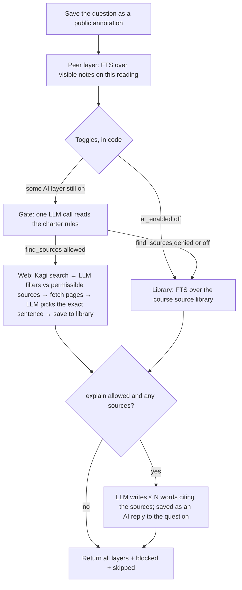

# How the backend works

A high-level tour of `app/backend/`, written Saturday 01:35. `SPEC.md` says *what* we're building; this explains *how the code is arranged* so you can find your way around and change it. If the code and this file disagree, the code wins: fix this file.

## The shape of it

The whole backend is **one Python process** (FastAPI, served by uvicorn) talking to **one SQLite file** (`app/backend/dialectic.db`). There's no ORM, no background workers and no cache server. Every request reads and writes the database directly with SQL, and the two outside services (the LLM and Kagi web search) are called with plain HTTP during the request.

```
browser ──HTTP──▶ main.py (routes) ──▶ db.py (SQLite + full-text search)
                     │
                     └─ /ask ──▶ ask.py ──▶ ai.py ─────▶ DigitalOcean LLM
                                         └▶ search.py ─▶ Kagi search, web pages
```

In production the same process also serves the built React app, so the whole site is one port behind Caddy.

## The files

| File | Lines | What it's for |
| --- | --- | --- |
| `main.py` | ~410 | Every HTTP route, plus small helpers that turn database rows into JSON. Start reading here. |
| `db.py` | ~180 | The schema (all `CREATE TABLE`s), `connect()`, the **visibility rule**, `insert_annotation()`, and `fts_query()`, which turns free text into a search query. |
| `ask.py` | ~200 | The `/ask` flow: the three answer layers and the charter checks, in order. |
| `ai.py` | ~225 | Everything that talks to the LLM: the four prompts (constants at the top), `chat()`, and the charter toggle checks. |
| `search.py` | ~75 | Kagi web search and fetching a page's main text, both cached in the database. |
| `seed.py` | ~155 | DEMO data: users, course, charter, and the past-student annotations. |
| `seed/souls-of-black-folk-ch1.pdf` | | The demo reading (Gutenberg #408, Ch. 1, printed with Chrome). |
| `pyproject.toml`, `uv.lock` | | Dependencies, managed with uv. |

Dependencies: `fastapi` + `uvicorn` (web server), `python-multipart` (PDF upload), `pypdf` (page text), `pdfplumber` (character positions, seed only), `httpx` (HTTP calls), `trafilatura` (extract an article's text from a web page).

## How a request flows

1. The frontend sends every request with an **`X-User-Id`** header (who you've "logged in as"; there are no passwords).
2. FastAPI runs the route's **dependencies** first. In `main.py`:
   - `get_conn()` opens a database connection and closes it after the request.
   - `current_user()` looks up the user from the header: 401 if unknown.
   - `professor()` is `current_user()` plus a 403 for students. A route that takes `user=Depends(professor)` is professor-only, and that's the whole permission system.
3. The route runs its SQL, calls `conn.commit()` if it wrote anything, and returns a dict, which FastAPI sends as JSON.
4. If anything raises, the `show_errors` handler returns a 500 with the **real error message** in `detail` (for example "DO_INFERENCE_KEY must be set"), so the frontend can show it instead of a vague failure.

## The data, in plain words

- **users**: name, role (`professor`, `student` or `ai`) and **cohort** (`Fall 2026` is the current class, `Spring 2026` is last year's). The AI is a user too ("Dialectic AI"), so its answers can sit in the margin like anyone else's.
- **annotations**: one table for everything people write on a reading:
  - `kind` is `note`, `question` or `ai_answer`.
  - `parent_id` makes something a reply (an AI answer is a reply to the question it answers).
  - `page`, `quote` and `rects` place the highlight: `rects` are boxes as *fractions* of the page size, so they redraw at any zoom.
- **readings** + **reading_pages**: the uploaded PDF's path, and each page's extracted text (for search and AI context).
- **charter**: one row holding the rules text, the permissible-sources description and the toggles.
- **sources**: the **course source library**. Every web page the AI used, plus any the professor added by hand.
- **web_cache**: search results and fetched pages, keyed by query or URL. It's demo insurance: once a question has been asked, it replays without the network. `seed.py --reset` keeps this table.

### Full-text search (FTS5)

SQLite's FTS5 keeps a word index alongside three tables: `annotations_fts`, `sources_fts` and `pages_fts`. Triggers in `db.py` update the index whenever an annotation or source is inserted or deleted, so you never maintain it by hand (a deleted annotation vanishes from search immediately, as the privacy promise says). `pages_fts` is filled once, at upload.

`db.fts_query("Where does double-consciousness come from?")` drops common words and builds `"double" OR "consciousness"`. Results are ranked with `bm25()`, where a lower score is a better match.

### The visibility rule

Who sees which annotation is one SQL snippet, `db.VISIBLE_SQL`, used by every query that returns annotations (the margin, `/ask`'s peer layer and `/search`). You see an annotation if:

- it's from **your cohort**, or
- its author is the **professor or the AI**, or
- it's from a **past cohort**, its author ticked "share with future classes", **and** the charter's `show_past_cohorts` toggle is on.

If this rule needs to change, change it there and everything follows.

## `/ask`, step by step

This is the heart of the product, in `ask.answer()`:



The points worth knowing:

- **Peers come first and need no AI.** The peer layer only searches `note`s (including replies), not other questions or AI answers, and boosts notes on the same page.
- **Two kinds of "no".** A toggle that's off blocks a layer *in code*, before any model call (`ai.toggle_blocks`). The **gate** (`ai.gate`) is an LLM call that reads the charter's rules text and can deny a layer citing a rule number; `ai.rule_label` turns "2" into "Rule 2: AI may point us to sources…". Either way the layer is added to `blocked`, and the request still succeeds.
- **The AI can't invent quotes.** When it picks "the sentence that answers the question" from a source, `ai.pick_sentences` checks that the sentence really appears in the page text and drops it otherwise. Kept sentences become text-fragment links (`url#:~:text=…`), which make the browser scroll to and highlight that sentence.
- **Sites that refuse us don't break the answer.** Britannica and The Atlantic answer our fetcher with 403. The filter returns up to 5 candidates, and `ask.web_layer` fetches them in order until 3 open; any that won't load are listed in `skipped_sources` as "Couldn't open this page".
- **The library grows by itself.** Every source the AI uses is saved to `sources`. Later questions, including ones where AI is off or denied, find it with plain full-text search.
- **No ungrounded answers.** The explanation is only written if there are sources to cite, and it's cut to `max_explanation_words` in code even if the model runs long.
- A full AI answer is **four LLM calls** (gate, filter, pick sentences, explain) plus a search and up to three page fetches. It's one slow request (expect 10–20 s), not a stream.

## Privacy, by construction

The functions in `ai.py` only take **strings**: charter text, the quote, the question, the reading title and source text. No route passes them a user, an id or another student's annotation, so none of that can leak into a prompt. Kagi receives only the gate's `search_query`, and fetched sites see a generic user agent.

## DEMO shortcuts (on purpose)

- **Seed annotations appear on upload.** The demo starts with the professor uploading the reading live, so last year's annotations can't exist beforehand. `POST /readings` checks the file name, and if it's `souls-of-black-folk-ch1.pdf`, it calls `seed.add_demo_annotations()`. The highlight boxes are computed from the real PDF with pdfplumber.
- **`seed.py --reset --with-reading`** sets up the same state without the live upload, in case it fails on stage.
- **`seed.py --reset --with-sources`** preloads the library with the SEP entry on Du Bois and Wikipedia's "Double consciousness", in case web search fails on stage. Add both flags to get everything.
- **Anyone can be anyone:** `X-User-Id` is trusted as is.

## Where to change things

| To change… | Edit |
| --- | --- |
| What the AI is told (gate, filter, sentence, explanation) | The `*_PROMPT` constants at the top of `ai.py` |
| The wording of "blocked by toggle" notices | `TOGGLE_LABELS` in `ai.py` |
| How many peer / library results show, the same-page boost | Constants at the top of `ask.py` |
| Seed users, charter text, demo annotations | Constants at the top of `seed.py` |
| Who can see what | `VISIBLE_SQL` in `db.py` |
| Which words search ignores | `STOPWORDS` in `db.py` |
| A route or response shape | `main.py`, **and** `SPEC.md` §6 in the same commit |

## Running and poking it

From `app/backend`:

```sh
uv run seed.py --reset --with-reading
uv run --env-file ../../.env uvicorn main:app --reload --port 8000
```

Then try it in another terminal (user 3 is Ben, user 1 is Prof. Rivera), or open <http://localhost:8000/docs> for FastAPI's clickable list of every route:

```sh
curl -H 'X-User-Id: 3' localhost:8000/api/readings/1/annotations
curl -X PUT -H 'X-User-Id: 1' -H 'Content-Type: application/json' -d '{"ai_enabled": false}' localhost:8000/api/charter
curl -H 'X-User-Id: 3' -H 'Content-Type: application/json' \
  -d '{"page": 2, "quote": "double-consciousness", "rects": [], "question": "Where does this idea come from?"}' \
  localhost:8000/api/readings/1/ask
```

## Known gaps (as of 01:35 Sat)

- **The AI path has only run against a faked LLM and Kagi**, because there are no API keys yet. The real model's JSON output and the real Kagi response format still need checking.
- **The gate may over-deny the demo question.** "What did it *mean* in 1903?" contains the word the rule-text demo relies on ("what does Du Bois *mean*…"). Test it with the real model.
- If an AI call fails, the question has already been saved, so it shows in the margin without an answer.
- Not built yet: `annotate_before_peers` (stretch) and the step-by-step "Checking the charter…" status (one response for now).
